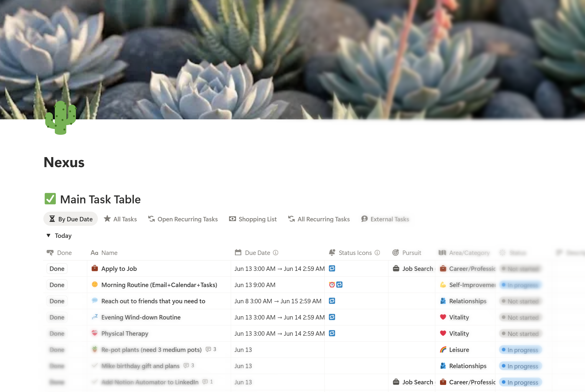

# Notion Automator

A self-hosted automation daemon that extends Notion with custom logic — running on your own hardware, on your own terms, no subscription required.

Notion's built-in automations are powerful but gated behind paid plans and limited to predefined actions. This daemon lets you write your own automation rules in Python and react to any change in your Notion databases within a configurable poll interval. Runs on any Linux system with systemd (Raspberry Pi, Ubuntu, Debian, etc.).



**[Duplicate the Notion template](https://dreamshark.notion.site/Task-Tracker-Nexus-Template-37d326b7c770805699c8d0478363c6e4)** to get the pre-built database setup, then follow the steps below to connect the daemon.

## Features

- **[Closed Date Stamping](#closed-date-stamping)** — automatically stamps a Closed Date when a task is marked done, and clears it on reopen.
- **[Reopen Count](#reopen-count)** — tracks how many times a task has been reopened.
- **[Field Tracking](#field-tracking)** — records the first observed value of any configured field and counts how many times it changes.
- **[Recurring Tasks](#recurring-tasks)** — keeps one open task per series at all times; creates the next task automatically when one is completed or cancelled. Supports habits, responsibilities, and more.
- **[Custom Automations](#adding-your-own-automations)** — write your own rules in Python with full access to page properties and change history.

---

## Table of Contents

- [Setup](#setup)
  - [1. Get a Notion Integration Token](#1-get-a-notion-integration-token)
  - [2. Find Your Database ID](#2-find-your-database-id)
  - [3. Install](#3-install)
  - [4. Configure](#4-configure)
  - [5. Test It](#5-test-it)
  - [6. Run as a System Service](#6-run-as-a-system-service)
- [Closed Date Stamping](#closed-date-stamping)
- [Reopen Count](#reopen-count)
- [Field Tracking](#field-tracking)
- [Recurring Tasks](#recurring-tasks)
- [Adding Your Own Automations](#adding-your-own-automations)
- [Tuning Poll Interval](#tuning-poll-interval)
- [How it compares to Notion's built-in automations](#how-it-compares-to-notions-built-in-automations)
- [Usage Guide](#usage-guide)
- [Updating](#updating)
- [Future Plans](#future-plans)

---

## Setup

### 1. Get a Notion Integration Token

1. Go to https://www.notion.so/my-integrations
2. Click **+ New integration** → give it a name → Submit
3. Copy the **Internal Integration Secret**
4. Open each Notion database you want to automate → `...` menu → **Add connections** → select your integration

### 2. Find Your Database ID

Open the database in Notion. The URL looks like:
```
https://www.notion.so/myworkspace/abc123def456...?v=...
```
The database ID is the UUID between your workspace name and `?v=`. Copy it without dashes.

### 3. Install

**Linux (Raspberry Pi / Debian / Ubuntu) — install system dependencies if not already present:**
```bash
sudo apt update && sudo apt install -y python3 python3-venv git
```

```bash
git clone https://github.com/DreamShark-Bytes/Notion_Automator
cd Notion_Automator

python3 -m venv venv
venv/bin/pip install -r requirements.txt
```

**Windows — install Python if not already present:**

1. Download Python 3.11+ from [python.org](https://www.python.org/downloads/) — check **"Add Python to PATH"** during install
2. (Optional) Install Git from [git-scm.com](https://git-scm.com/) to clone via terminal, or download the repo as a ZIP

```powershell
git clone https://github.com/DreamShark-Bytes/Notion_Automator
cd Notion_Automator

python -m venv venv
venv\Scripts\pip install -r requirements.txt
```

`requirements.txt` includes the pinned [Notion_API](https://github.com/DreamShark-Bytes/Notion_API) dependency — no separate install step needed.

**Compatibility**

| Notion Automator | Notion API |
|---|---|
| v1.x | v1.x |

### 4. Configure

The three example files are in different folders: [`config_example.toml` (project folder)](config_example.toml) is the template for `config.toml`, [`config_secrets_example.toml` (project folder)](config_secrets_example.toml) is the template for the token file, and [`docs/config_row_example.toml` (docs folder)](docs/config_row_example.toml) is the commented example of a config row.

**Linux:**
```bash
cp config_example.toml config.toml
nano config.toml
```

**Windows:**
```powershell
copy config_example.toml config.toml
notepad config.toml
```

At minimum, set your integration token (see "Where the token goes" below) and say which databases to automate. That goes in a Configuration Hub config row (below) or, without a Hub, in a file named `config_automations.toml` next to `config.toml`, in the same format as a config row. One block for each data source you want to automate:

```toml
[[property_automations]]
data_source_id = "your-data-source-id"
```

**Where the token goes.** The token lives in `config_secrets.toml`, next to `config.toml`, so the config file holds no secret and can be shared or read freely. Copy [`config_secrets_example.toml` (project folder)](config_secrets_example.toml) to `config_secrets.toml` and replace the placeholder (`token = "ntn_..."`). `config_secrets.toml` is gitignored. Restrict it so only you and the service can read it: on Linux `chmod 600 config_secrets.toml` (the daemon logs a warning if it is group- or world-readable); on Windows `install-service.ps1` runs `icacls` on it for you. The file is plain text on purpose: an unattended daemon has to be able to read it at boot, so an encryption key would have to sit next to it. To keep it elsewhere, start the daemon with `--secrets PATH`. There is no environment variable, because a stale one would silently override the file. At startup the log says where the token came from (`Notion token source: ...`; the value is never logged). If the daemon will not start, check the log: a missing token names the path it looked at, and a malformed file reports the line and column. Do not paste the token into a prompt or a command run through an AI assistant. A `token = "..."` line in `config.toml` still works as a deprecated fallback and logs a warning.

Enable individual features per data source by adding keys to the block. See each feature section below for the exact keys, and `docs/config_reference.md` for every key.

**Notion API version.** The daemon uses Notion API version `2026-03-11` by default. To use a different one, add `notion_version = "2025-09-03"` (or `"2022-06-28"`) to `config.toml`. Version differences are described in Notion's upgrade guides: [2025-09-03](https://developers.notion.com/guides/get-started/upgrade-guide-2025-09-03) (databases become data sources) and [2026-03-11](https://developers.notion.com/guides/get-started/upgrade-guide-2026-03-11) (`archived` becomes `in_trash`). The database IDs in `config.toml` keep working on the new versions as long as the database has a single data source. Requires `Notion_API` v1.4.0 or later (`pip install -r requirements.txt`).

### Setting up the Configuration Hub (optional)

New install? `docs/initial_setup.md` walks through it in order. A commented example of the code block with every key is in [`docs/config_row_example.toml` (docs folder)](docs/config_row_example.toml).

**Starting without the Hub.** Leave `config_hub_data_source_id` out of `config.toml` and write the config in a file named `config_automations.toml` next to it, in the same format as a config row ([`docs/config_row_example.toml` (docs folder)](docs/config_row_example.toml)). Without the Hub there is no Report, Warnings or Errors in Notion: problems go to the log. The Hub is worth setting up once you want those and want to change behavior without editing files or restarting. The old `[[databases]]` and `[recurring_tasks]` entries in `config.toml` are no longer read: the daemon stops and prints the converted text to paste into a config row or `config_automations.toml` (`docs/upgrade_steps.md`).

The Hub lets you change behavior in Notion instead of editing `config.toml`. It is one Notion data source, which you create yourself (the bot never creates it, so it also never needs a parent page):

1. **Duplicate the template** (a Notion page with the data source already set up; link to be added with the first release). If you cannot use the template, create the data source by hand with the columns below.
2. Share it with your integration (Notion: `...` > Connections).
3. Copy the data source ID (Notion app: open the data source, three-dots menu top right > More > Developer > Copy data source ID) into `config.toml` as `config_hub_data_source_id`.
4. Start the daemon. The data source may be shared with other tools: the Automator only ever reads and writes its own row. It finds it by the page ID saved in `config_hub_state.toml` (`automator_config_page_id`), then by the default name `Automator`; if neither matches it creates one. The new config row is created without a Status, so it is inert until you set it to `Active`. Edit the TOML in its code block, then set Status to `Active`. You can rename the row once the ID is saved. To pause the Automator, set the row's Status to anything but `Active`.

**Config data source** (the Automator uses one row; other tools can keep theirs in the same data source):

| Column | Type | Notes |
|---|---|---|
| Name | Title | Anything |
| Status | Status | Needs an option named `Active`; any other options (for example `Inactive`) work. Only `Active` rows are applied |
| Errors | Text | Bot-written. Cleared when resolved |
| Warnings | Text | Bot-written. Cleared when resolved |
| Last verified time | Date | Optional. You add it; the bot never creates it. After a governance pass with no failures, the bot sets it on each Active row that read without errors. An old date means the bot has not confirmed that row lately. Must be a Date property: Notion does not let the bot write a "Last edited time" property |
| Config Version (Datetime) | Date | Optional. You add it, and only you set it: set it to now (by hand, or with an "Apply Config" button) when a changed config should be loaded. See "When the config is applied" below |
| Report | Text | Optional. Bot-written, one line each for the app (`App: Version X, Started: time`, no emoji because it reports no status), a `config.toml` line when that file had problems, the last config read and the last governance pass; the config and governance lines start with an emoji (🟢 fine, 🟡 see Warnings or an edit is being waited on, 🔴 see Errors, ⚪ paused) and a time to the minute with its zone. Times are shown in the time zone of the Config Version value (so they follow the Notion time zone of whoever last set it; this machine's zone until a Config Version with a zone has been read); this is display only and never affects what counts as a changed config. Plain text for you to read; the bot never reads it back |

The row's page body holds exactly one code block of TOML. The bot never edits it:

```toml
[[property_automations]]          # one block per task data source
name = "tasks"
data_source_id = "..."
closed_date_property = "Closed Date"
reopen_count_property = "Reopen Count"
update_count_properties = ["Due Date"]
first_value_properties = ["Due Date", "Status"]

[[recurring_tasks]]               # one block per pair; a data source is in one block only
definitions_data_source_id = "..."
tasks_data_source_id = "..."
inherit_include_properties = ["Priority", "Effort"]
non_completion_statuses = ["Cancelled", "Skipped"]
```

Leave a key out to switch that feature off. Put `#` in front of every line of a block to switch the block off. Lists are arrays, so a property name may contain commas.

**When the config is applied.** Only a row whose Status is `Active` runs. Whatever is running always equals exactly what the Active rows say, with no daemon restart:

| What you do | What the bot does |
|---|---|
| Set Status to `Active` | Reads the code block, applies it, runs a governance pass |
| Set Status to anything else | Stops everything from that row (its task data sources and recurring pairs) without reading the page. Edits made while it is paused are read when you set it back to `Active` |
| Set Config Version (Datetime) to a different value (a newer time, or any other) | Reads the code block, applies it, runs a governance pass |
| Edit the code block without changing Config Version | Nothing is applied. After the row has been unchanged for the settle time (default 5 minutes, `hub_settle_seconds` in `config.toml`) the bot compares the code block with what is running; if it differs, the Warnings column says "Edited but not applied" and why it would not apply (for example a TOML error with its line). Comment, spacing and key-order edits never warn |
| No Config Version column | An edit is applied once the row has been unchanged for the settle time |
| Start the daemon | Reads the code block once |

The daily governance pass does not re-read the config, but it does compare each row's code block with what is running (the safety net behind the Warning above).

**Apply Config button (optional, set up once in the Notion app).** The bot cannot create a button's action through the API, so add it by hand: add a Button property named `Apply Config`, give it the action "Edit property" > `Config Version (Datetime)` > set to "Now". After a change, press it. Leaving `Config Version (Datetime)` empty is allowed: the bot then only reads the row when it is activated or the daemon restarts, and warns that nothing will be applied by an edit.

**A config with a problem never stops a working one.** If an apply finds an error (invalid TOML, a bad ID), the config that was already running stays, the Warnings column says so, and the Report line reads `🔴 Config: apply failed, still running version ...`. Fix the code block and set Config Version again to retry. Only a row with nothing loaded (first activation, or a restart with a broken block) shows the problem as an Error. Messages in Errors and Warnings start with their source in brackets (`[config]`, `[governance]`); a very long list ends with `(N more, see the log)`.

**The stored copy, `config_automations.toml`.** After each apply that had no Errors, the bot writes the row's code block to `config_automations.toml` next to `config.toml`, exactly as you wrote it (comments and spacing included), under a header line that says the bot wrote it. It is used in two cases: the config row is deleted (below), and the Hub cannot be reached at startup after it has worked once (the daemon then runs from the copy and logs a warning). Do not edit it while the Hub is in use: the next apply overwrites it. If a file with that name exists that the bot did not write, the bot leaves it alone, puts a Warning on the row, and keeps no copy until you rename it.

**If the config row is deleted.** A read that does not find the row asks Notion for the saved page. Only if Notion says the page is gone or in the trash does the bot create a new row. If the page still exists elsewhere (moved to another data source) nothing is created and the log says where it is: move it back. The new row is restored from the stored copy and is `Active`, with a note above the code block that links the earlier row, or, if no copy exists (the config was never applied), a blank example row that is not Active. The Warnings column says what happened and links every earlier row of the chain; it clears after 24 hours, or when you set Config Version again. Setting Status to `On hold` stops the automations; deleting the row does not. At most 2 rows are created in a row (`hub_max_recreations` in `config.toml`, counted in `config_hub_state.toml`); the last one writes an Error that automatic recreation then stops until a restart, so a loop that keeps deleting the row cannot create pages forever.

**Problems in `config.toml` itself.** A value the daemon cannot use (for example an unknown `week_start`, or `day_start_hour` that is not a number) falls back to its default and shows in Warnings as `[config.toml] ...`, with a Report line `🟡 config.toml: N warning(s), see Warnings`. A missing token or ID stops the daemon instead, and that is only in the log.

**Upgrading from an earlier Hub setup.** There is no separate status data source or kill switch any more. Delete `status_data_source_id` from `config.toml` (the daemon logs a warning until you do) and set the config row's Status to anything but `Active` to pause the Automator. You can delete the old status data source in Notion. The bot drops `automator_status_page_id` from `config_hub_state.toml` on the next start.

### 5. Test It

**Linux:**
```bash
venv/bin/python daemon.py
```

**Windows:**
```powershell
venv\Scripts\python daemon.py
```

You should see polling logs every 60 seconds. Make a change in Notion and watch it react.

### 6. Run as a System Service (auto-start on boot)

#### Linux — systemd

Edit the service file **before** copying it — replace both placeholder values:

| Placeholder | Replace with |
|---|---|
| `YOUR_USER` | your Linux username (e.g. `vince`) |
| `/path/to/Notion_Automator` | absolute path to this repo (e.g. `/home/vince/Documents/Notion_Automator`) |

```bash
nano notion-daemon.service

sudo cp notion-daemon.service /etc/systemd/system/
sudo systemctl daemon-reload
sudo systemctl enable notion-daemon
sudo systemctl start notion-daemon

# Check status / logs
sudo systemctl status notion-daemon
journalctl -u notion-daemon -f
```

#### Windows — NSSM

[NSSM](https://nssm.cc/) (Non-Sucking Service Manager) wraps the daemon as a proper Windows service — auto-starts on boot, restarts on failure, runs while locked.

1. Download NSSM from [nssm.cc/download](https://nssm.cc/download) — extract and put `nssm.exe` somewhere permanent (e.g. `C:\Tools\nssm.exe`)

2. Open `install-service.ps1` in a text editor and set `$ProjectDir` and `$NssmPath` to match your machine.

3. Open **PowerShell as Administrator** and run:

```powershell
Set-ExecutionPolicy -Scope Process -ExecutionPolicy Bypass
.\install-service.ps1
```

4. Manage the service from **PowerShell**:

```powershell
Start-Service NotionAutomator
Stop-Service NotionAutomator
Get-Service NotionAutomator
```

To list all NSSM-managed services (useful if you forget the service name):

```powershell
Get-CimInstance Win32_Service | Where-Object PathName -match 'nssm.exe' | Format-Table Name, DisplayName, State
```

Or open **services.msc** and find **Notion Automator** in the list.

> **Note:** Avoid using `sc` in PowerShell — it is aliased to `Set-Content`, not the Service Control Manager. Use `Start-Service` / `Stop-Service` / `Get-Service` instead, or run `sc.exe` (with the `.exe` extension) if you prefer the `sc` syntax.

Logs are written to `notion_daemon.log` in the project directory.

---

## Closed Date Stamping

Automatically stamps a **Closed Date** field when a task moves to the Done status group, and clears it if the task is reopened. If you pre-fill Closed Date before closing (e.g. to backdate a completion), the bot leaves your value in place.

On daemon startup, any task already in Done without a Closed Date gets backfilled from its `last_edited_time`.

### Notion setup

Add a **Date** field named `Closed Date` to your task database.

### Config

```toml
[[property_automations]]
data_source_id       = "your-data-source-id"
closed_date_property = "Closed Date"
```

---

## Reopen Count

Increments a **Reopen Count** field each time a task moves out of the Done status group. Useful for tracking how often a task gets re-opened after being marked complete.

Requires Closed Date Stamping to be enabled, since reopen detection relies on the same status transition logic.

**Daemon-downtime recovery:** if a task was closed while the daemon was running (Closed Date stamped), then the user reopened it while the daemon was offline, the daemon will see a non-Complete task that still has a Closed Date set when it restarts. It treats this as a missed reopen: Reopen Count is incremented and Closed Date is cleared. This is self-healing — no manual correction needed.

### Notion setup

Add a **Number** field named `Reopen Count` to your task database.

### Config

```toml
[[property_automations]]
data_source_id        = "your-data-source-id"
closed_date_property  = "Closed Date"      # required
reopen_count_property = "Reopen Count"
```

---

## Field Tracking

Two config keys tell the bot which fields to watch. Both use naming conventions so no explicit field mapping is needed.

### First value snapshot

For each field listed in `first_value_fields`, the bot looks for a column named `First [Field Name]` in the database and stamps it with the field's first observed non-empty value. The stamp is write-once: the bot never overwrites it. If you clear it manually, the bot re-stamps on the next poll.

Supported field types: Date, Select, Status, Number, Text, URL, Email, Phone.

**Example:** add `"Due Date"` to get `First Due Date` stamped automatically. Add `"Status"` to capture the status a task had when first seen.

### Update count

For each field listed in `update_count_fields`, the bot looks for a `[Field Name] Update Count` number column and increments it whenever the value changes. For Date fields, only a change to the date portion counts; a time-only adjustment on the same day does not increment the counter.

### Notion setup

Create columns in your task database following the naming convention:

| Column name | Type | Tracks |
|---|---|---|
| `First Due Date` | Date | First value of Due Date |
| `Due Date Update Count` | Number | How many times Due Date changed |
| `First Status` | Text | Status when task was first seen |
| `Status Update Count` | Number | How many times Status changed |

Add only the columns you want. Missing columns are silently skipped.

### Config

```toml
[[property_automations]]
data_source_id          = "your-data-source-id"
first_value_properties  = ["Due Date"]
update_count_properties = ["Due Date"]
```

---

## Recurring Tasks

Keeps one open task per series at all times. When a task is marked Done or Cancelled, the bot automatically creates the next one for the appropriate period.

### Notion setup — Definitions database

Create a new database in Notion with these fields:

| Field               | Type      | Notes                                                                                                                                                    |
| ---------------------| -----------| ----------------------------------------------------------------------------------------------------------------------------------------------------------|
| Name                | Title     |                                                                                                                                                          |
| Type                | Select    | `Habit`, `Bad Habit`, `Responsibility`                                                                                                                   |
| Status              | Status    | Bot only creates tasks when Status = `Active`                                                                                                            |
| Cadence Type        | Select    | `Once per period`, `Exactly N per period`, `Maximum N per period`, `Minimum N per period`, `Unlimited`                                                   |
| N Cadence           | Number    | Used by cadence types that reference N; blank for others                                                                                                 |
| Period              | Select    | `Day`, `Week`, `Month`, `Year`                                                                                                                           |
| Anchor Day          | Number    | Mon=1 … Sun=7 for weekly; 1–31 for monthly (overflows to last day of month)                                                                              |
| Anchor Time         | Text      | e.g. `13:00`; blank = no specific time                                                                                                                   |
| Grace Period (days) | Number    | Responsibilities only — auto-cancelled this many days past due; blank = 1-day default; set 0 to cancel immediately after anchor time                     |
| Current Period      | Date      | Optional — bot writes the current period's start and end datetimes each governance pass; enables Notion formulas that filter tasks to the current period |
| Notes               | Rich Text |                                                                                                                                                          |
| Last Completed      | Rollup    | Max of `Closed Date` from related tasks                                                                                                                  |

### Notion setup — Task database

Add these fields to your main tasks database:

| Field                                     | Type     | Required | Notes                                                                         |
| -------------------------------------------| ----------| ----------| -------------------------------------------------------------------------------|
| Recurring Series                          | Relation | Yes      | Points to the Definitions database                                            |
| Closed Date                               | Date     | Yes      | Required for period logic — see [Closed Date Stamping](#closed-date-stamping) |
| Occurrence # this Period (Recurring Task) | Number   | No       | Count of completions this period; filled in by the bot                        |
| Period Key (Recurring Task)               | Text     | No       | Display label for the current period — written by the bot, do not edit        |
| Period Target (Recurring Task)            | Text     | No       | e.g. `Minimum 3 per Week` — set by the bot at creation                        |
| Ignore Grace Period (Recurring Task)      | Checkbox | No       | Prevents grace-period auto-cancellation for this specific task instance. The bot sets this automatically when you reopen a Responsibility task, but you can also check it manually — useful when you've customized a task (renamed it, adjusted the due date) and don't want it auto-cancelled. New tasks from the series always start with this unchecked. |

Connect your integration to both databases (`...` menu → **Add connections**).

### Config

In `config.toml` (global settings):

```toml
# Controls when the logical day begins (affects all period calculations).
# Times between midnight and this hour are attributed to the previous calendar day.
# Also sets when the daily governance cron fires. Default: 3 (3am).
day_start_hour = 3

# First day of the week. Affects weekly recurring task period boundaries.
# Default: "Sunday" (matches Notion). Use "Monday" for ISO/work-week convention.
week_start = "Sunday"
```

In a config row's code block (or `config_automations.toml`):

```toml
[[property_automations]]
data_source_id       = "your-tasks-data-source-id"
closed_date_property = "Closed Date"      # required for recurring task period logic

[[recurring_tasks]]
definitions_data_source_id = "your-definitions-data-source-id"
tasks_data_source_id       = "your-tasks-data-source-id"
# What the next task copies from the closed one (default: nothing, and the definition's icon is copied):
# inherit_include_properties = ["Priority", "Effort"]   # or "all" (a list is required even for one name)
# inherit_exclude_properties = ["Notes"]                # only with "all"
# inherit_icon               = true                     # false: tasks are created without the icon
```

Then add it to the `AUTOMATIONS` list at the bottom of the file.

See `DESIGN.md` for the full automation signature, governance system, and architecture details.

---

## Tuning Poll Interval

Set `poll_interval` in `config.toml` (applies to all databases).

- **60s** (default) — good balance, ~1440 API calls/day per database
- **30s** — more responsive, ~2880 calls/day
- Notion's free tier rate limit is 3 requests/second — you won't come close.

---

## How it compares to Notion's built-in automations

| Feature                   | This daemon                  | Notion built-in |
| ---------------------------| ------------------------------| -----------------|
| Trigger on change         | ✅ (within poll interval)     | ✅ (instant)     |
| Custom logic in Python    | ✅                            | ❌               |
| Recurring tasks           | ✅                            | ✅               |
| Outbound webhooks         | ✅ (add your own code)        | ✅ (paid plans)  |
| Always-on device required | ✅ (Raspberry Pi works great) | ❌               |
| Subscription required     | ❌                            | ✅               |

---

## Usage Guide

Tips for configurations that are valid but non-obvious. Useful once you're familiar with the features.

**`day_start_hour` — setting your logical day boundary:**
By default, the daemon treats 3am as the start of a new day. Any task completed between midnight and 3am is attributed to the *previous* calendar day's period. This prevents an accidental late-night close from counting toward the next day's quota. If you regularly work past 3am, increase this value (e.g. `day_start_hour = 4`). If you have an extreme schedule (e.g. sleep at 11am, wake at 6pm), set it to shortly after you wake up — periods will be labeled with the calendar date of your waking day. The same setting controls when the daily governance cron fires.

**`Minimum N per period` with Anchor Day:**
If all N repetitions of an activity happen at the same scheduled event (e.g. a weekly meeting, a class, a practice), `Minimum N per period` is probably not the right cadence. Use `Once per period` with Anchor Day set to that event's day instead. Completing the task means you showed up; how many times you did something *during* the event is detail that belongs in the task name or notes, not in N. `Minimum N per period` is better suited to activities spread across the period with no fixed day.

**Two recurring event days per period (e.g. Tuesday and Thursday):**
The system supports one Anchor Day per series definition. To track a recurring activity that happens on two specific days per week, create two separate definitions — one anchored to Tuesday, one to Thursday — each with `Once per period`. Using `Minimum 2 per period` with no anchor would give you a due date spanning the full period but would not enforce the specific days.

**Applying RTD config changes immediately:**
Changing an RTD's `Period`, `Cadence Type`, or `N Cadence` doesn't trigger governance right away — the change takes effect at the next daemon startup or daily governance cron. To apply it immediately without waiting: set the RTD's Status to inactive, wait one poll cycle (default 60s), then set it back to Active. The Status → Active transition triggers an immediate governance run that drift-corrects all affected tasks. A one-click Force Governance option is planned as part of the Configuration Hub.

**Protecting a customized Responsibility task from auto-cancellation:**
If you edit a specific recurring task instance — renaming it, changing the due date, scoping it to a particular case — you may not want the grace period cron to cancel it on schedule. Check `Ignore Grace Period (Recurring Task)` directly on that task. The bot will skip it during every grace period evaluation for as long as it stays open. When you close it, the next task in the series is created fresh with the checkbox unchecked, so normal behavior resumes automatically.

**`Current Period` field — filtering tasks to the current period in Notion:**
Add a `Current Period` Date field to your definitions database. Governance writes the current period's start and end datetimes to it on every governance pass. You can then use a Notion formula on your task pages to check whether a task's Due Date falls within the current period:

```
prop("Recurring Series").map(current.prop("Current Period")).map(
  dateStart(current) <= prop("Due Date") and dateEnd(current) >= prop("Due Date")
).includes(true)
```

Pair this with a rollup on the definitions database to count tasks completed this period — more accurate than a bot-maintained counter and requires no extra writes.

---

## Updating
### Linux
1. Stop the service: `sudo systemctl stop notion-daemon`
2. Back up any files you've edited: `automations.py` and `config.toml` are the only ones you're expected to modify
3. Pull the latest changes: `git pull`
4. Install any new dependencies: `venv/bin/pip install -r requirements.txt --force-reinstall`
   - This also updates [Notion_API](https://github.com/DreamShark-Bytes/Notion_API) if the pinned version changed. The release notes will call this out explicitly when it applies.
5. Apply any Notion-side changes listed in the release notes (field renames, new select options, new columns)
6. Update `config.toml` to match any new config format changes
7. Start the service: `sudo systemctl start notion-daemon`
8. Check logs to confirm governance ran cleanly: `journalctl -u notion-daemon -f`

To diff your local `automations.py` against the new version before overwriting: `git diff HEAD automations.py`

### Windows

1. Stop the service: `Stop-Service NotionAutomator`
2. Back up any files you've edited: `automations.py` and `config.toml` are the only ones you're expected to modify
3. Pull the latest changes: `git pull`
4. Install any new dependencies: `venv\Scripts\pip install -r requirements.txt --force-reinstall`
   - This also updates [Notion_API](https://github.com/DreamShark-Bytes/Notion_API) if the pinned version changed. The release notes will call this out explicitly when it applies.
5. Apply any Notion-side changes listed in the release notes (field renames, new select options, new columns)
6. Update `config.toml` to match any new config format changes
7. Start the service: `Start-Service NotionAutomator`
8. Check logs to confirm governance ran cleanly: open `notion_daemon.log` in the project directory, or tail it in PowerShell: `Get-Content -Path .\notion_daemon.log -Tail 50 -Wait`

To diff your local `automations.py` against the new version before overwriting: `git diff HEAD automations.py`

---

## Credits

Developed in collaboration with [Claude Code](https://claude.ai/code) by Anthropic. All architectural decisions, requirements definition, design reviews, testing, and production deployment are owned by the human author. Claude assisted with implementation, debugging, and documentation under directed oversight — not vibe-coding, but a design-led workflow where nothing ships without human review and approval.

---

## Future Plans

See `PLANNED.md` for full details.

- **Configuration Hub** (formerly "Automation Hub") — A set of Notion pages as the daemon's home base. Surfaces health, errors, and warnings; eventually replaces `config.toml` for behavioral settings that change frequently.
- **Extended Cadence** — Support for cadences spanning multiple periods (bi-weekly, quarterly, etc.) with a simplified picker and a Custom mode.
- **Notifications** — Outbound webhook support (Discord, Telegram) for alerts on governance events.
- **Change Tracking** — Opt-in field change log with old/new values and timestamps, feeding into reporting tools.

----
<p style="text-align:center;">This project is licensed under the terms of the MIT license.</p>
